

2026.10.23 — 10.25TIANJIN · PKU DS LAB

十月二十三日至二十五日，和 **PKU DS Lab** 的伙伴们一起去了天津。

三天不算长，照片却留下了不少画面：海河上的光、天津之眼的红色轮廓、街头的老建筑，以及饭桌和牌桌旁那些很日常的时刻。再翻开相册，想起的已经不只是去过哪些地方，还有这趟旅程里一起度过的时间。

## 海河的夜色

最醒目的是天津之眼。夜幕下，红色的摩天轮从树梢后升起，远远就能看见；换个角度，隔着窗户，仍然是那个熟悉的圆。

沿着海河看过去，岸边的柳树、桥梁、楼宇和游船各自亮着灯。水面把这些颜色揉在一起，让照片里的天津比白天多了一层光影。

<figure class="tianjin-gallery__photo">
  <a href="/images/diary/2026-10-tianjin-ds-lab/haihe-riverside.jpg" target="_blank" rel="noopener" aria-label="查看照片原图：夜晚海河沿岸的树木、水面与灯光">
    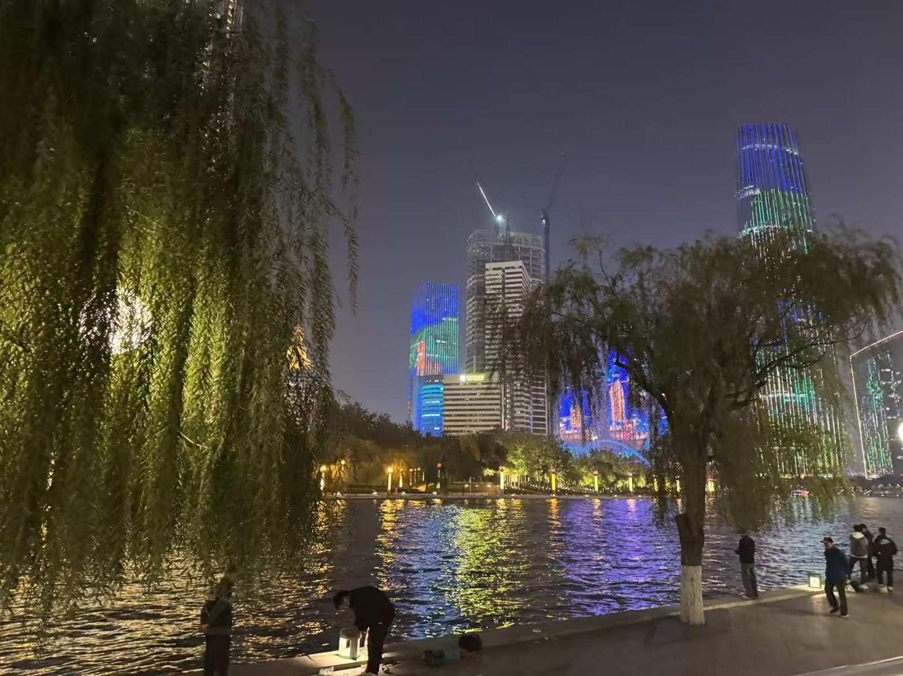
  </a>
  <figcaption>海河边，树影与灯光倒映在水里。</figcaption>
</figure>
<figure class="tianjin-gallery__photo">
  <a href="/images/diary/2026-10-tianjin-ds-lab/haihe-lights.jpg" target="_blank" rel="noopener" aria-label="查看照片原图：天津海河沿岸的高楼灯光">
    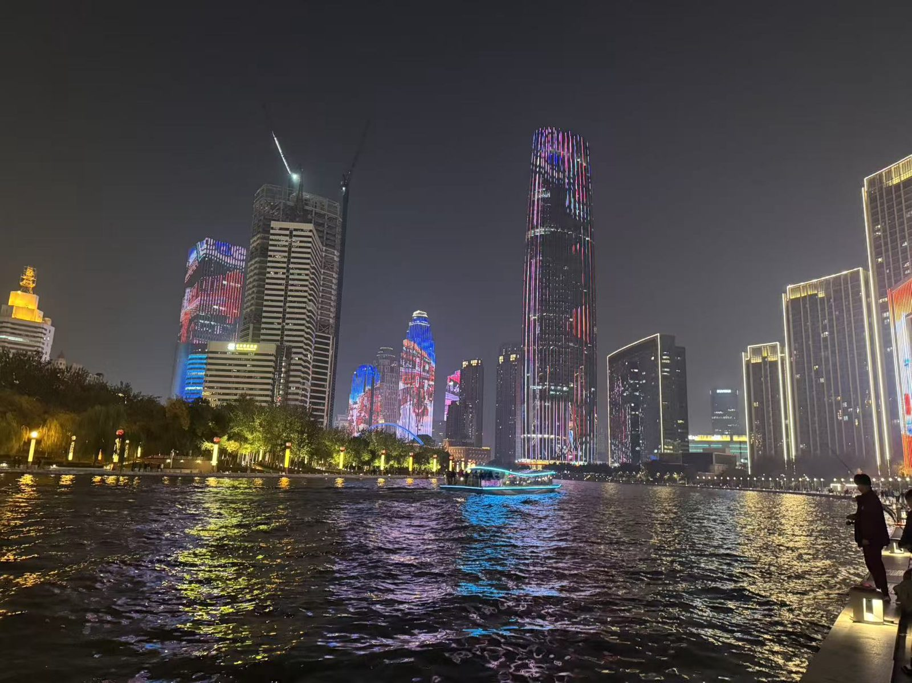
  </a>
  <figcaption>河岸另一侧的城市灯火。</figcaption>
</figure>
<figure class="tianjin-gallery__photo tianjin-gallery__photo--wide">
  <a href="/images/diary/2026-10-tianjin-ds-lab/haihe-boat.jpg" target="_blank" rel="noopener" aria-label="查看照片原图：海河上游船经过，背景是点亮的城市天际线">
    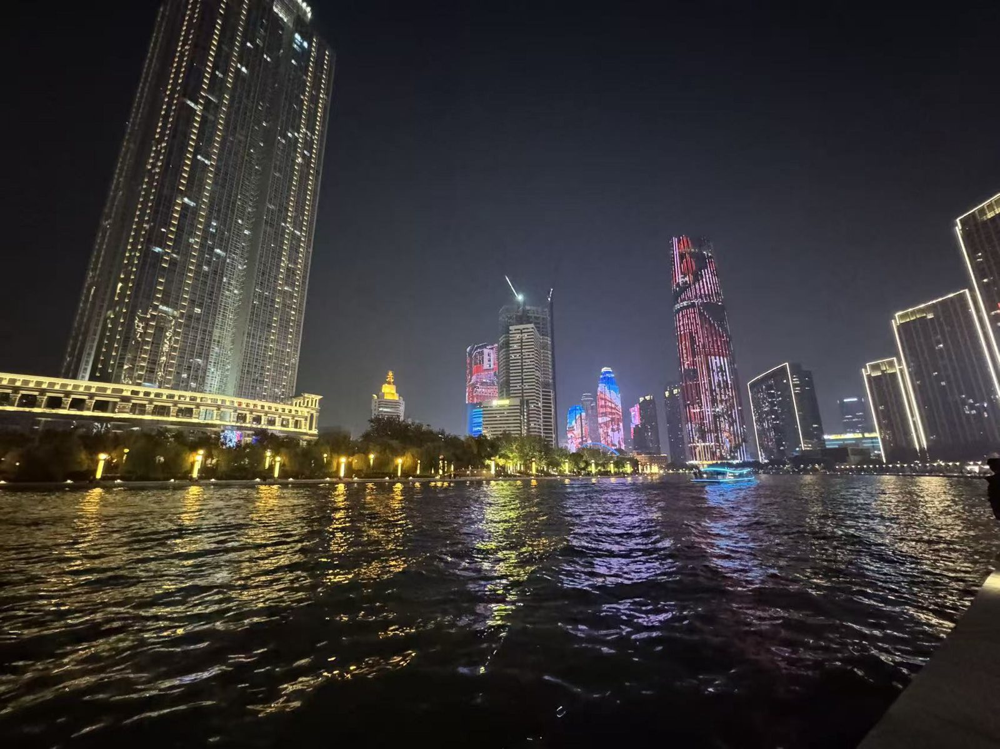
  </a>
  <figcaption>水面上的灯光和经过的船。</figcaption>
</figure>
<figure class="tianjin-gallery__photo">
  <a href="/images/diary/2026-10-tianjin-ds-lab/haihe-bridge.jpg" target="_blank" rel="noopener" aria-label="查看照片原图：夜色中横跨海河的亮灯桥梁">
    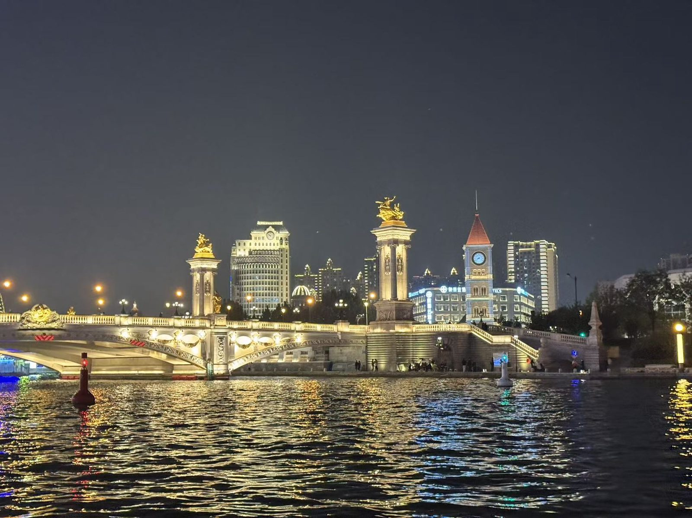
  </a>
  <figcaption>灯火勾勒出桥的轮廓。</figcaption>
</figure>
<figure class="tianjin-gallery__photo">
  <a href="/images/diary/2026-10-tianjin-ds-lab/city-skyline.jpg" target="_blank" rel="noopener" aria-label="查看照片原图：夜晚天津城市街道与高楼灯光">
    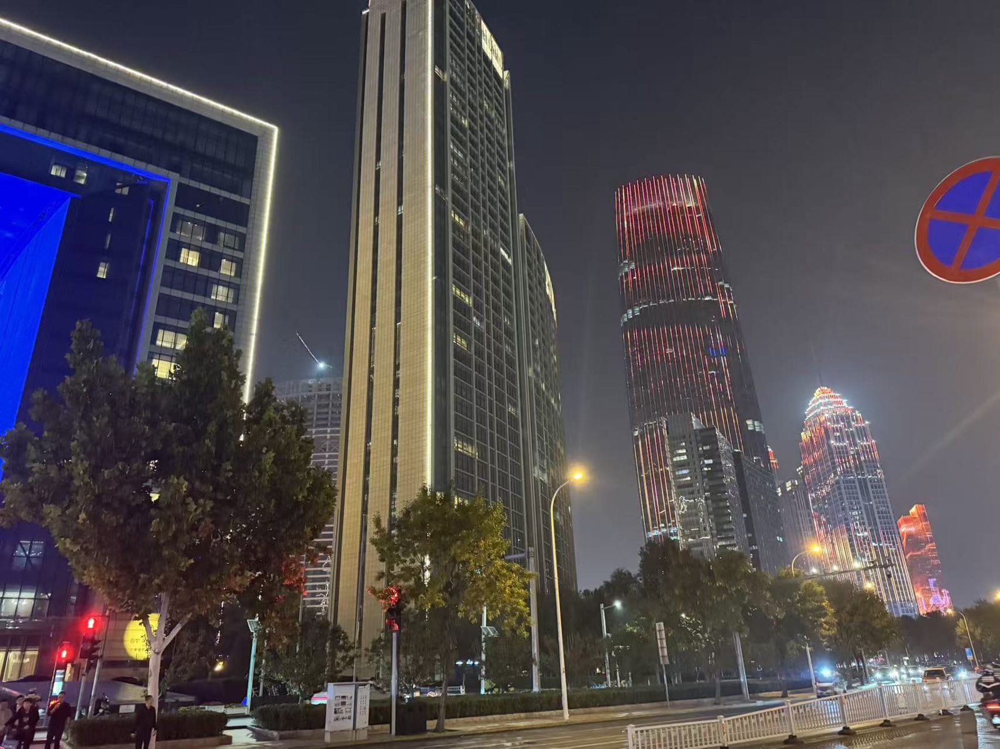
  </a>
  <figcaption>抬头看，楼宇在夜色里亮起。</figcaption>
</figure>
<figure class="tianjin-gallery__photo tianjin-gallery__photo--wide">
  <a href="/images/diary/2026-10-tianjin-ds-lab/tianjin-eye-window.jpg" target="_blank" rel="noopener" aria-label="查看照片原图：透过玻璃拍摄的天津之眼夜景">
    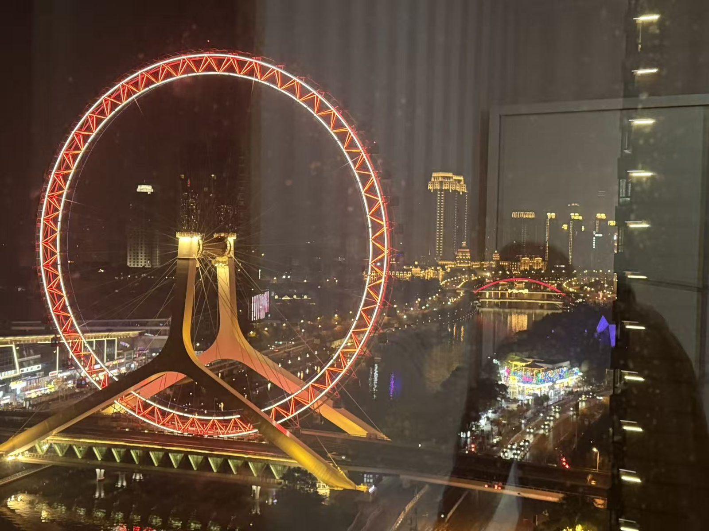
  </a>
  <figcaption>隔着窗户望见的天津之眼。</figcaption>
</figure>

## 街巷与餐桌

天津也有另一种值得慢慢看的风景：劝业场的建筑、街边带着雕饰的外墙、世纪钟的巨大钟面。它们与夜晚的行人和招牌并排出现，让城市不只有天际线。

当然还少不了吃的。菜单上密密麻麻的家常菜与海鲜，以及那盘蒜蓉生蚝，给这几天留下了很具体的味道。

<figure class="tianjin-gallery__photo tianjin-gallery__photo--wide">
  <a href="/images/diary/2026-10-tianjin-ds-lab/night-shopping-street.jpg" target="_blank" rel="noopener" aria-label="查看照片原图：夜间天津劝业场及街头行人">
    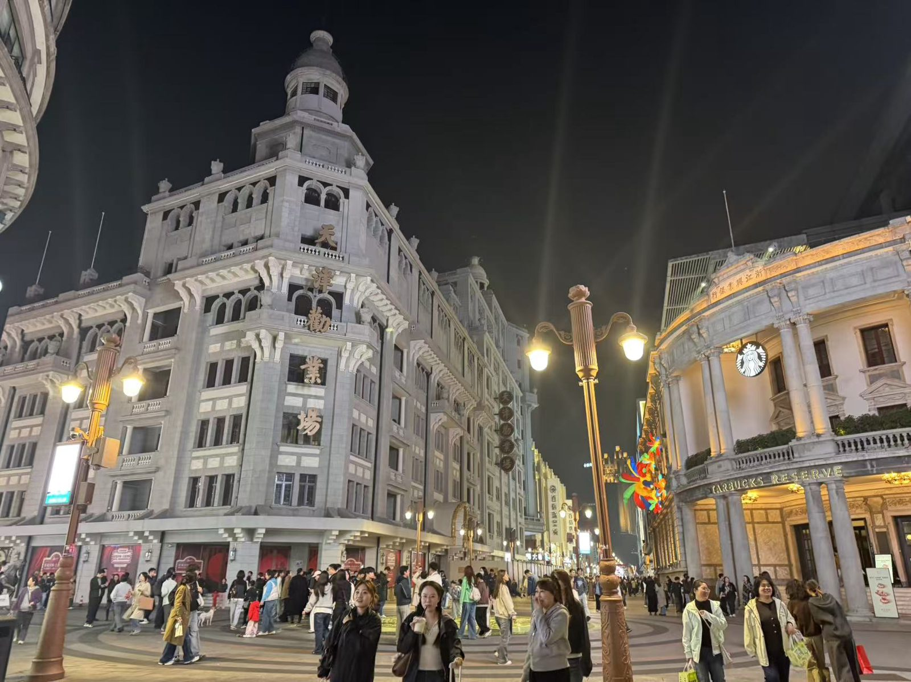
  </a>
  <figcaption>街头的灯光与劝业场建筑。</figcaption>
</figure>
<figure class="tianjin-gallery__photo tianjin-gallery__photo--portrait">
  <a href="/images/diary/2026-10-tianjin-ds-lab/historic-building.jpg" target="_blank" rel="noopener" aria-label="查看照片原图：装饰有雕刻和彩色牌匾的天津街边历史建筑">
    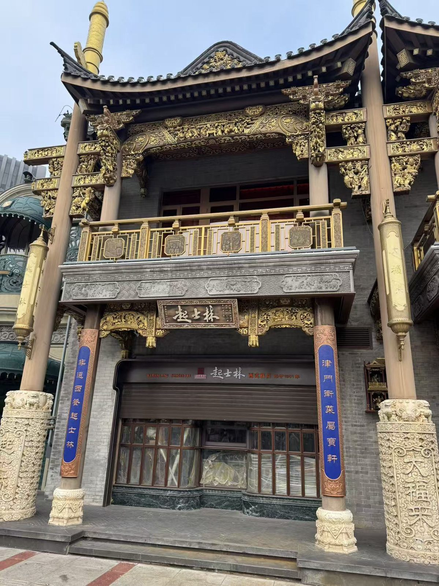
  </a>
  <figcaption>路过的老建筑，值得多看一眼。</figcaption>
</figure>
<figure class="tianjin-gallery__photo tianjin-gallery__photo--portrait">
  <a href="/images/diary/2026-10-tianjin-ds-lab/century-clock.jpg" target="_blank" rel="noopener" aria-label="查看照片原图：天津世纪钟的钟面与周边建筑">
    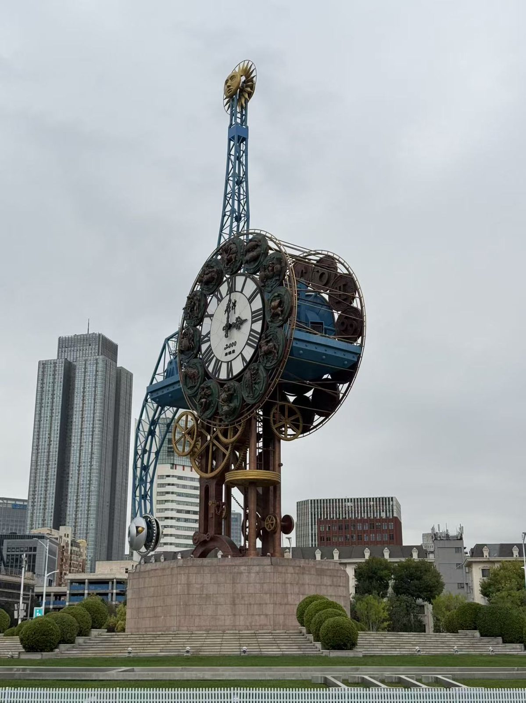
  </a>
  <figcaption>天津世纪钟。</figcaption>
</figure>
<figure class="tianjin-gallery__photo tianjin-gallery__photo--wide">
  <a href="/images/diary/2026-10-tianjin-ds-lab/food-menu.jpg" target="_blank" rel="noopener" aria-label="查看照片原图：天津餐馆里展示家常菜和海鲜的菜单牌">
    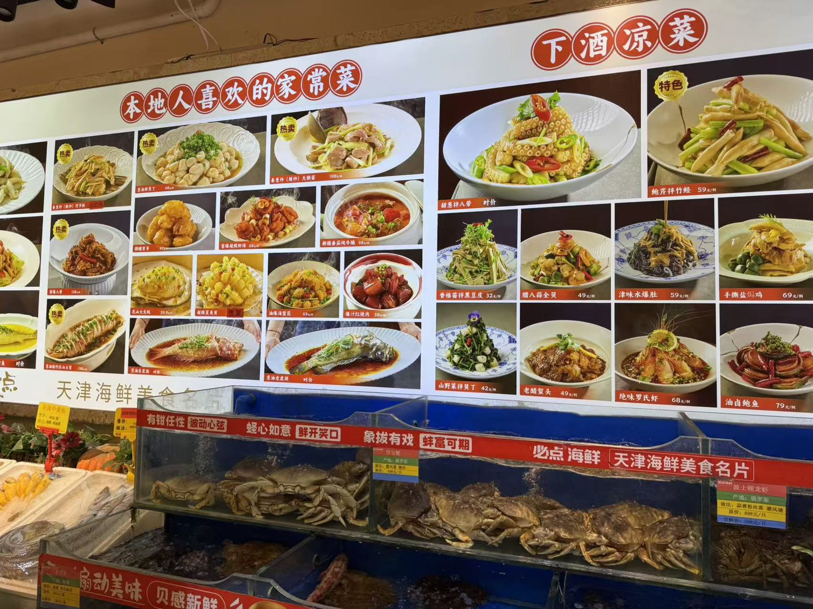
  </a>
  <figcaption>墙上满满的家常菜与海鲜。</figcaption>
</figure>
<figure class="tianjin-gallery__photo tianjin-gallery__photo--portrait">
  <a href="/images/diary/2026-10-tianjin-ds-lab/oysters.jpg" target="_blank" rel="noopener" aria-label="查看照片原图：餐盘里摆放的蒜蓉生蚝">
    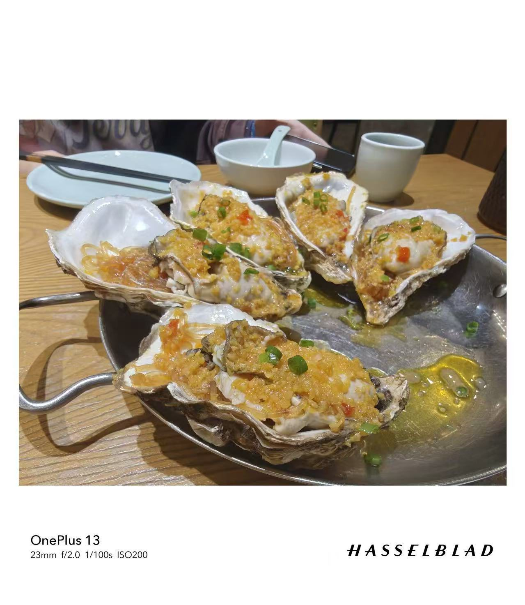
  </a>
  <figcaption>一盘蒜蓉生蚝。</figcaption>
</figure>

## 在一起的时间

相册里还有一些不属于景点的照片：围坐着打牌的桌子、摆满饮料的台面，还有可以一起坐下、歇一会儿的室内空间。

这些场景没有摩天轮那样醒目，却是我想保留下来的部分。旅行并不总是赶往下一个地方；有时候，能和同伴待在一起，把节奏放慢，就已经很好。

<figure class="tianjin-gallery__photo tianjin-gallery__photo--portrait">
  <a href="/images/diary/2026-10-tianjin-ds-lab/cards.jpg" target="_blank" rel="noopener" aria-label="查看照片原图：同行的人围坐在桌边玩牌，桌上有纸牌和筹码">
    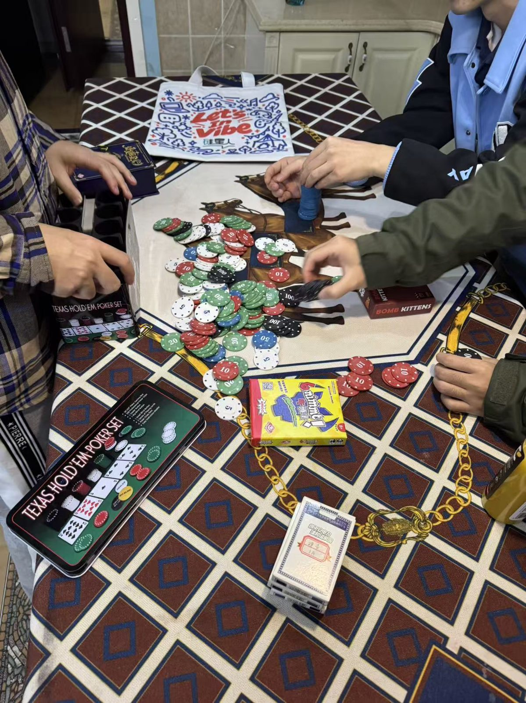
  </a>
  <figcaption>同伴们围坐的牌桌。</figcaption>
</figure>
<figure class="tianjin-gallery__photo">
  <a href="/images/diary/2026-10-tianjin-ds-lab/drinks.jpg" target="_blank" rel="noopener" aria-label="查看照片原图：桌上整齐摆放的瓶装水和多种饮料">
    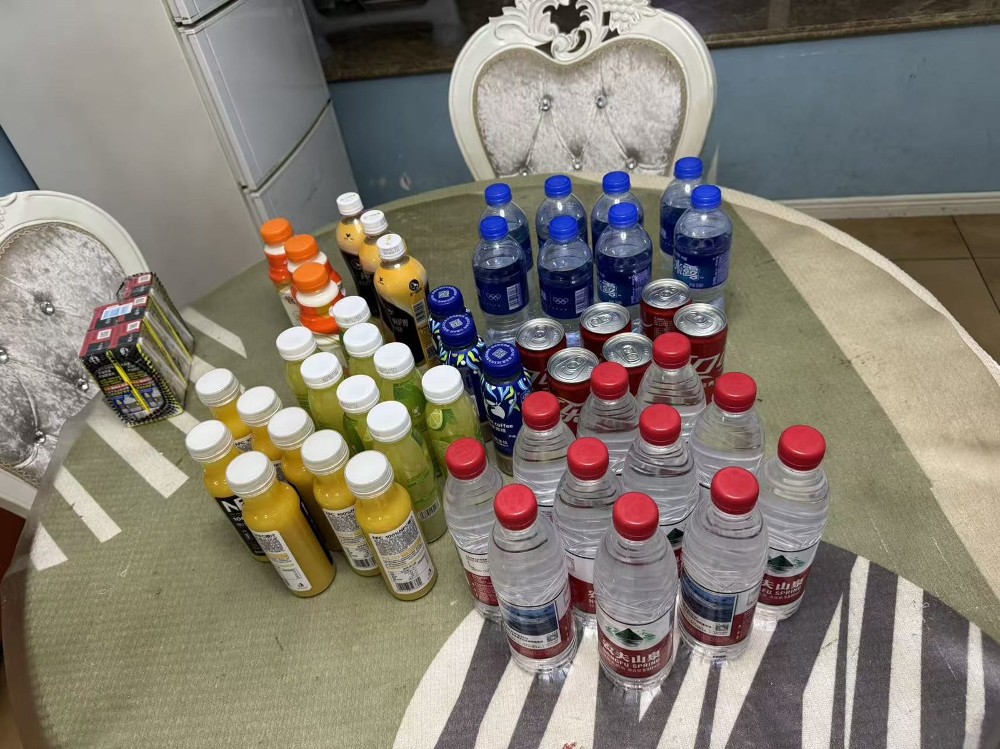
  </a>
  <figcaption>摆满饮料的桌面。</figcaption>
</figure>
<figure class="tianjin-gallery__photo">
  <a href="/images/diary/2026-10-tianjin-ds-lab/lounge.jpg" target="_blank" rel="noopener" aria-label="查看照片原图：天津行程中室内客厅、沙发与灯光">
    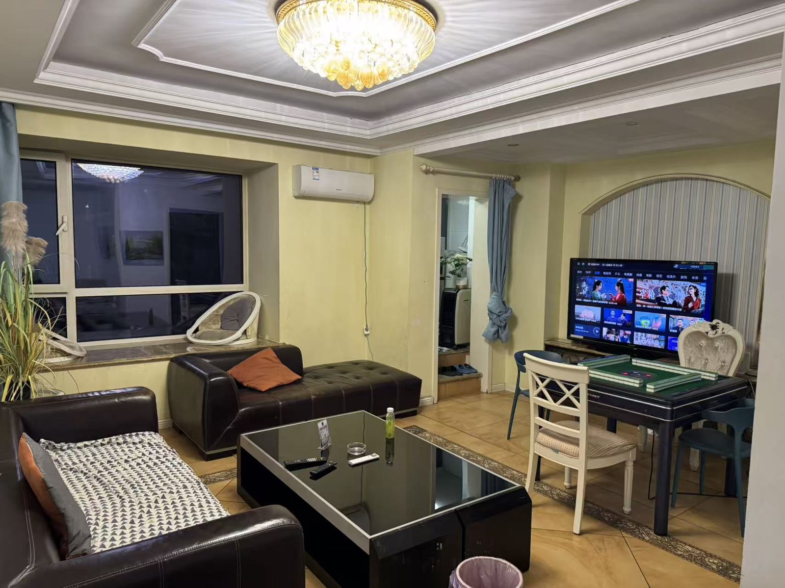
  </a>
  <figcaption>旅途中可以歇脚的室内空间。</figcaption>
</figure>
<figure class="tianjin-gallery__photo">
  <a href="/images/diary/2026-10-tianjin-ds-lab/shared-space.jpg" target="_blank" rel="noopener" aria-label="查看照片原图：有餐桌、客厅和暖色灯光的室内公共空间">
    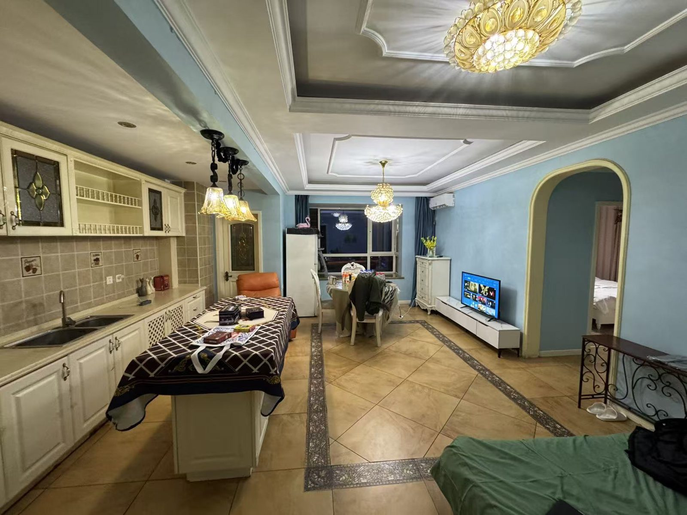
  </a>
  <figcaption>把脚步放慢的一处室内角落。</figcaption>
</figure>

三天结束，照片替这趟天津之行留下了一个小小的索引。以后再看到那道红色的摩天轮、海河的倒影，或者桌上的牌和饮料，应该也会记起当时同行的人。

**2026.10.23—10.25，天津。**

